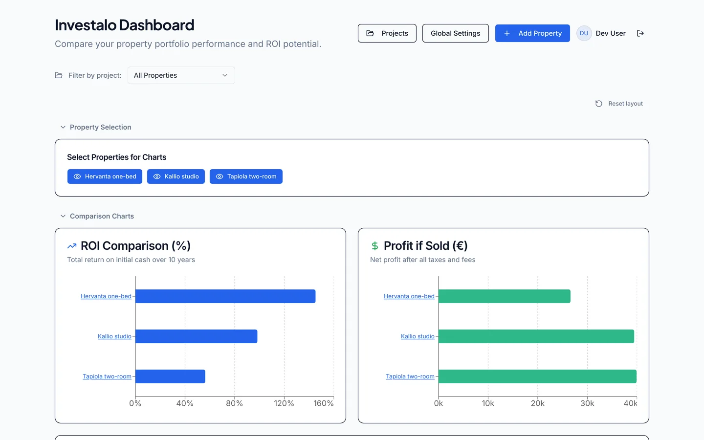
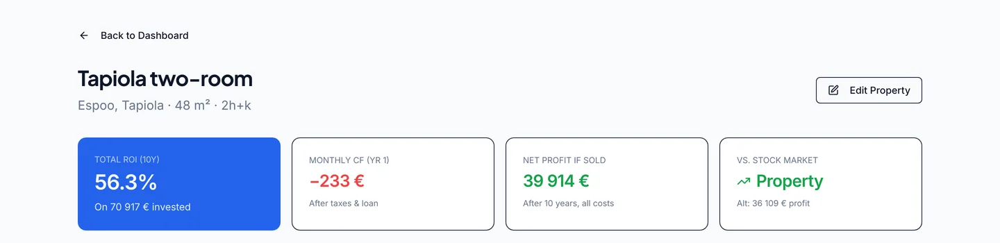
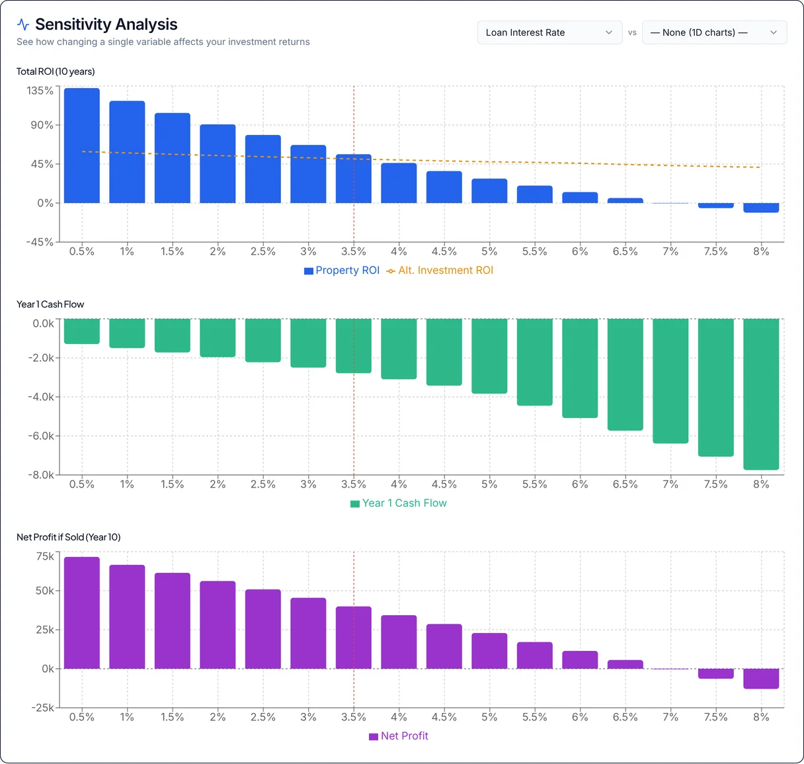

# Investalo · Property Investment Analyzer

A full-stack web app for evaluating and comparing buy-to-let apartments, built around the Finnish tax and housing-company rules that make back-of-the-envelope spreadsheets error-prone. It simulates each property year by year (loan, rent, costs, taxes, appreciation, sale) and shows how the result holds up when the assumptions change.



## What it does

- **Year-by-year simulation.** Annuity loan schedule, vacancy, maintenance and financing charges, rent and value growth, and the outcome of selling in any year: net profit, ROI on cash invested and loan-to-value.
- **Finnish tax model.** Transfer tax on the debt-free price, tiered capital income tax (30 % / 34 % above a threshold), *hankintameno-olettama* (the 20 % / 40 % deemed acquisition cost, applied only when it lowers the gain), rental loss carry-forward against later capital income, and the broker commission with VAT. A generic market profile switches the Finnish-specific rules off, and an optional depreciation deduction covers markets that allow one.
- **Sensitivity analysis.** Vary interest rate, vacancy, appreciation, rent, price, holding period or alternative-investment return, one at a time or as a two-parameter heatmap, across a single property or the whole portfolio.
- **Benchmark against index funds.** Every scenario is compared with investing the same cash flows in the stock market, including capital gains tax on the alternative.
- **Portfolio tools.** Group properties into projects, filter the dashboard, view locations on a map, and export or import portfolios as JSON.
- **Optional Claude features.** Import a listing from its URL, review a listing against an investment due-diligence checklist ([`investment-property-guardrails.md`](investment-property-guardrails.md)), and get a market assessment of the asking price, achievable rent and an offer range.





## Tech stack

| Layer | Technology |
|---|---|
| Frontend | React 18, TypeScript, Vite, Tailwind CSS, shadcn/ui (Radix) |
| Data and forms | TanStack Query, React Hook Form, Zod |
| Charts and maps | Recharts, Leaflet |
| Backend | Express 5, TypeScript |
| Database | PostgreSQL, Drizzle ORM (migrations run on startup) |
| Auth | Google OAuth 2.0 via Passport, Postgres-backed sessions |
| AI | Anthropic Claude API |
| Tooling | Vitest, esbuild, GitHub Actions, Docker |

## Getting started

Requires Node.js 20.18+ and PostgreSQL.

```bash
git clone https://github.com/KalastajaM/investalo.git
cd investalo
npm install
cp .env.example .env    # set DATABASE_URL and SESSION_SECRET
```

For local use without Google credentials, set `DEV_MODE=true` in `.env`. Every request then runs as a local test user. Never enable it on a public deployment.

```bash
npm run dev             # http://localhost:5000
```

Migrations apply automatically when the server starts. To enable the Claude features, set `ANTHROPIC_API_KEY`; set `CLAUDE_FEATURES=false` to hide them. Every variable is documented in [`.env.example`](.env.example).

### Scripts

| Command | Description |
|---|---|
| `npm run dev` | Express and Vite dev server with HMR |
| `npm run build` | Production build of client and server into `dist/` |
| `npm start` | Run the production build |
| `npm run check` | TypeScript type check |
| `npm test` | Unit tests (Vitest) |
| `npm run db:generate` | Generate a migration from schema changes |

## Project structure

```
client/src/
  lib/simulation.ts     Simulation and tax engine (pure, unit-tested)
  lib/market-configs.ts Market profiles (Finland, generic)
  pages/, components/   Dashboard, property details, settings, projects
server/
  routes.ts             REST API
  auth/                 Google OAuth, DEV_MODE, sessions
  safe-fetch.ts         SSRF-safe fetching of user-supplied URLs
  scraper.ts, analyzer.ts, market-analyzer.ts   Claude features
shared/
  schema.ts             Drizzle tables and Zod schemas shared by client and server
  routes.ts             Typed API contract
migrations/             SQL migrations
tests/                  Simulation, Claude response parsing, URL safety
```

## Design notes

- **One schema, both sides.** Drizzle table definitions generate the Zod validators used by the API and the forms, so client and server cannot drift.
- **The simulation runs in the browser.** It is a pure function of a property and the user's settings, which keeps sensitivity sweeps (hundreds of simulations) instant and makes the engine easy to test.
- **User-supplied URLs are untrusted.** Listing URLs are fetched through `safe-fetch.ts`, which checks every resolved address at connect time (so DNS rebinding cannot bypass it), blocks private, loopback, link-local and metadata ranges, and re-validates each redirect.
- **Per-user isolation.** Every query is scoped by user ID and enforced by foreign keys; Claude endpoints are rate-limited per user.

## Deployment

The included `Dockerfile` and `railway.toml` deploy to Railway or any container host. Provide `DATABASE_URL`, `SESSION_SECRET`, the Google OAuth credentials and `APP_URL` (the public base URL for the OAuth callback). `/health` serves as the health check.

## Disclaimer

The calculations are estimates for comparing scenarios, not tax or investment advice. Tax rules and rates change; review the defaults in Settings before relying on the results.

## License

MIT. See [LICENSE](LICENSE).
